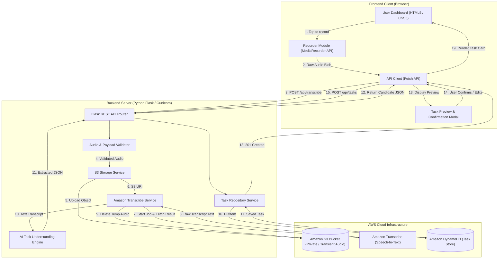
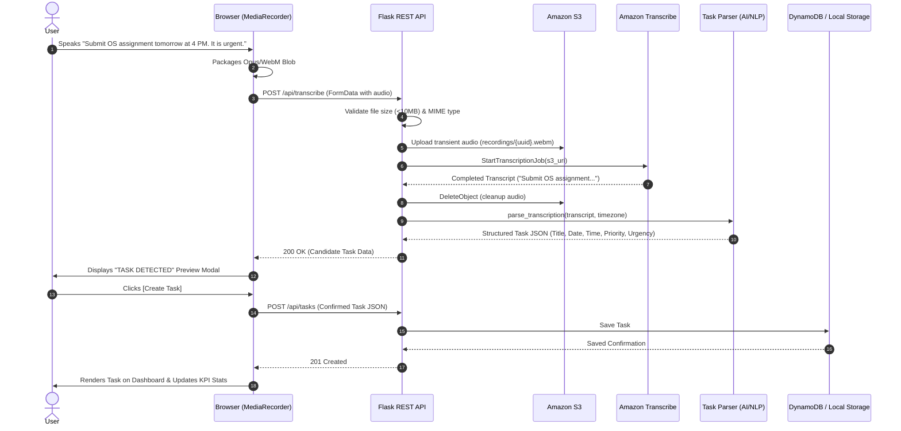
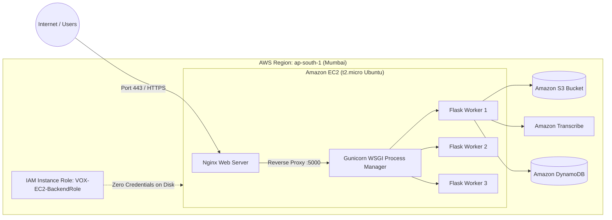
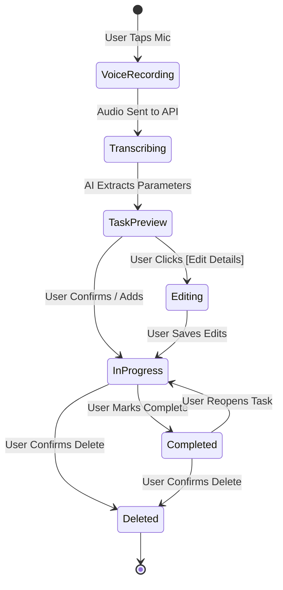

# System Architecture & Technical Diagrams

Comprehensive architectural documentation and Mermaid diagrams for **VOX - AI Voice-to-Text Task Manager using AWS**.

---

## 1. System Architecture Diagram

---

## 2. Voice-to-Task Sequence Diagram

---

## 3. Deployment Architecture Diagram

---

## 4. Task Lifecycle State Machine

