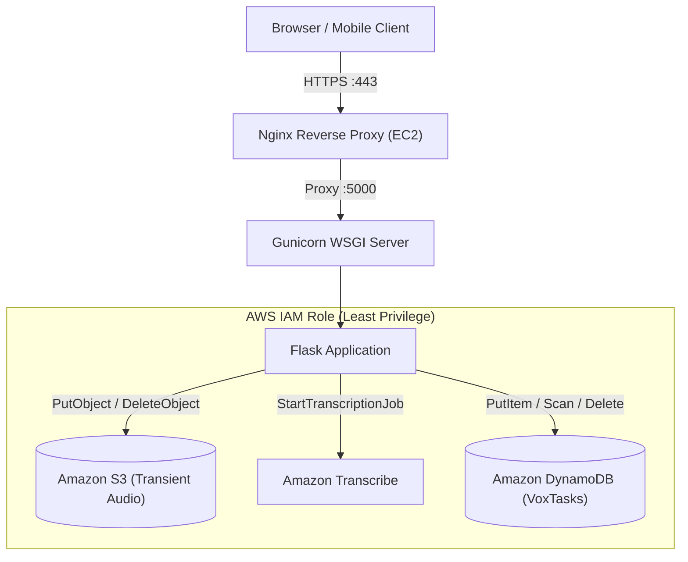

# AWS Deployment & Cloud Architecture Guide

A beginner-friendly, production-ready guide to deploying the **AI Voice-to-Text Task Manager (VOX)** onto Amazon Web Services (AWS).

---

## 1. Cloud Architecture Overview



---

## 2. AWS Pre-Requisites & Region Selection

1. **AWS Account**: Sign up at [aws.amazon.com](https://aws.amazon.com).
2. **Region Selection**:
   * For India / Asia: `ap-south-1` (Mumbai).
   * For US: `us-east-1` (N. Virginia).
   * Keep all services (S3, Transcribe, DynamoDB, EC2) in the **SAME** region to minimize network latency and eliminate cross-region data transfer fees.

---

## 3. Step-by-Step AWS Service Setup

### Step 3.1: Create Amazon S3 Bucket
1. Go to **AWS Console** &rarr; Search for **S3**.
2. Click **Create bucket**.
3. **Bucket name**: `vox-audio-recordings-YOURNAME` (must be globally unique).
4. **AWS Region**: Select `ap-south-1` (Mumbai).
5. **Block Public Access**: Leave **"Block all public access" CHECKED** (100% Private). Audio is never exposed to the public internet.
6. Click **Create bucket**.

#### S3 Lifecycle Rule (Automatic Cleanup Safeguard)
1. Click on your newly created bucket &rarr; **Management** tab &rarr; **Create lifecycle rule**.
2. **Rule name**: `DeleteTransientAudioAfter1Day`.
3. Select **"Apply to all objects in the bucket"**.
4. Check **"Expire current versions of objects"** & set **Days after creation** to `1`.
5. Click **Create rule**. *(This ensures that even if a server crashes mid-upload, files are automatically deleted after 24 hours, guaranteeing zero storage cost).*

---

### Step 3.2: Create Amazon DynamoDB Table
1. Search for **DynamoDB** &rarr; Click **Create table**.
2. **Table name**: `VoxTasks`.
3. **Partition key**: `task_id` (Type: **String**).
4. **Sort key**: Leave empty.
5. **Table settings**: Select **Customized settings** &rarr; Choose **On-demand** capacity (or Free-Tier Provisioned 5 RCU / 5 WCU).
6. Click **Create table**.

---

### Step 3.3: Create IAM Role for EC2 (Crucial Security Step)
> [!IMPORTANT]
> **Zero Credential Rule**: We never place `AWS_ACCESS_KEY_ID` or `AWS_SECRET_ACCESS_KEY` on our production EC2 server. Instead, we attach an **IAM Role** to the EC2 instance. The AWS SDK (`boto3`) automatically obtains temporary credentials behind the scenes.

1. Search for **IAM** &rarr; Click **Roles** &rarr; **Create role**.
2. Select **AWS service** &rarr; Choose **EC2** as the use case &rarr; Click **Next**.
3. Create an inline policy with these least-privilege permissions:
```json
{
  "Version": "2012-10-17",
  "Statement": [
    {
      "Sid": "S3TransientAudioAccess",
      "Effect": "Allow",
      "Action": [
        "s3:PutObject",
        "s3:GetObject",
        "s3:DeleteObject"
      ],
      "Resource": "arn:aws:s3:::vox-audio-recordings-YOURNAME/*"
    },
    {
      "Sid": "AmazonTranscribeAccess",
      "Effect": "Allow",
      "Action": [
        "transcribe:StartTranscriptionJob",
        "transcribe:GetTranscriptionJob"
      ],
      "Resource": "*"
    },
    {
      "Sid": "DynamoDBTaskStoreAccess",
      "Effect": "Allow",
      "Action": [
        "dynamodb:PutItem",
        "dynamodb:GetItem",
        "dynamodb:Scan",
        "dynamodb:UpdateItem",
        "dynamodb:DeleteItem"
      ],
      "Resource": "arn:aws:dynamodb:*:*:table/VoxTasks"
    }
  ]
}
```
4. Name the role: `VOX-EC2-BackendRole` & click **Create role**.

---

### Step 3.4: Launch Amazon EC2 Virtual Server
1. Search for **EC2** &rarr; Click **Launch instance**.
2. **Name**: `VOX-Production-Server`.
3. **OS**: **Ubuntu Server 24.04 LTS** (Free Tier eligible).
4. **Instance type**: `t2.micro` (or `t3.micro`).
5. **Key pair**: Create new key pair `vox-ec2-key.pem` and download it to your PC.
6. **Network / Security Group**:
   * Allow SSH (Port 22) from your IP.
   * Allow HTTP (Port 80) from Anywhere (0.0.0.0/0).
   * Allow HTTPS (Port 443) from Anywhere (0.0.0.0/0).
7. Under **Advanced details** &rarr; **IAM instance profile**: Select `VOX-EC2-BackendRole`.
8. Click **Launch instance**.

---

## 4. Server Configuration & Deployment Steps

Connect to your EC2 instance via SSH:
```bash
ssh -i vox-ec2-key.pem ubuntu@YOUR_EC2_PUBLIC_IP
```

### Step 4.1: Install System Packages
```bash
sudo apt update && sudo apt upgrade -y
sudo apt install -y python3-pip python3-venv nginx git
```

### Step 4.2: Clone Application
```bash
git clone https://github.com/YOUR_USERNAME/VOX.git /var/www/vox
cd /var/www/vox/backend
```

### Step 4.3: Setup Virtual Environment & Dependencies
```bash
python3 -m venv .venv
source .venv/bin/activate
pip install -r requirements.txt
pip install gunicorn
```

### Step 4.4: Configure Environment Variables
Create `/var/www/vox/backend/.env`:
```env
PORT=5000
FLASK_ENV=production
FLASK_DEBUG=False
TIMEZONE=Asia/Kolkata
CORS_ORIGINS=*

STORAGE_BACKEND=dynamodb
DYNAMODB_TABLE_NAME=VoxTasks

AWS_REGION=ap-south-1
S3_BUCKET_NAME=vox-audio-recordings-YOURNAME
```
*(Notice: No access keys! The attached IAM role provides credentials automatically).*

---

### Step 4.5: Configure Systemd Service (Gunicorn Auto-Start)
Create `/etc/systemd/system/vox.service`:
```ini
[Unit]
Description=VOX AI Task Manager Gunicorn Application
After=network.target

[Service]
User=ubuntu
Group=www-data
WorkingDirectory=/var/www/vox/backend
Environment="PATH=/var/www/vox/backend/.venv/bin"
ExecStart=/var/www/vox/backend/.venv/bin/gunicorn --workers 3 --bind 127.0.0.1:5000 "app:create_app()"
Restart=always

[Install]
WantedBy=multi-user.target
```

Enable and start the service:
```bash
sudo systemctl daemon-reload
sudo systemctl enable vox
sudo systemctl start vox
sudo systemctl status vox
```

---

### Step 4.6: Configure Nginx Web Server
Create `/etc/nginx/sites-available/vox`:
```nginx
server {
    listen 80;
    server_name YOUR_EC2_PUBLIC_IP;

    location / {
        proxy_pass http://127.0.0.1:5000;
        proxy_set_header Host $host;
        proxy_set_header X-Real-IP $remote_addr;
        proxy_set_header X-Forwarded-For $proxy_add_x_forwarded_for;
        proxy_set_header X-Forwarded-Proto $scheme;

        # Support large audio upload chunks
        client_max_body_size 15M;
    }
}
```

Activate and reload Nginx:
```bash
sudo ln -s /etc/nginx/sites-available/vox /etc/nginx/sites-enabled/
sudo rm -f /etc/nginx/sites-enabled/default
sudo nginx -t
sudo systemctl restart nginx
```

---

## 5. Cost Management & Resource Deletion Checklist

As a college student, you want to avoid surprise charges:

### AWS Services Cost Profile:
* **EC2 `t2.micro`**: 750 hours/month Free Tier.
* **Amazon S3**: 5 GB storage free. Since our backend immediately deletes audio after transcription, S3 storage fee is essentially **$0.00**.
* **Amazon DynamoDB**: 25 GB free tier, 25 WCU/RCU free permanently.
* **Amazon Transcribe**: 60 minutes/month free for the first 12 months.

### Project Teardown Checklist (When Done Testing / Presenting):
1. **Stop / Terminate EC2**: Go to EC2 &rarr; Select `VOX-Production-Server` &rarr; Instance State &rarr; **Terminate instance**.
2. **Empty & Delete S3 Bucket**: Go to S3 &rarr; Empty bucket &rarr; Delete bucket.
3. **Delete DynamoDB Table**: Go to DynamoDB &rarr; Tables &rarr; Select `VoxTasks` &rarr; Delete table.
4. **Delete IAM Role**: Go to IAM &rarr; Roles &rarr; Delete `VOX-EC2-BackendRole`.
